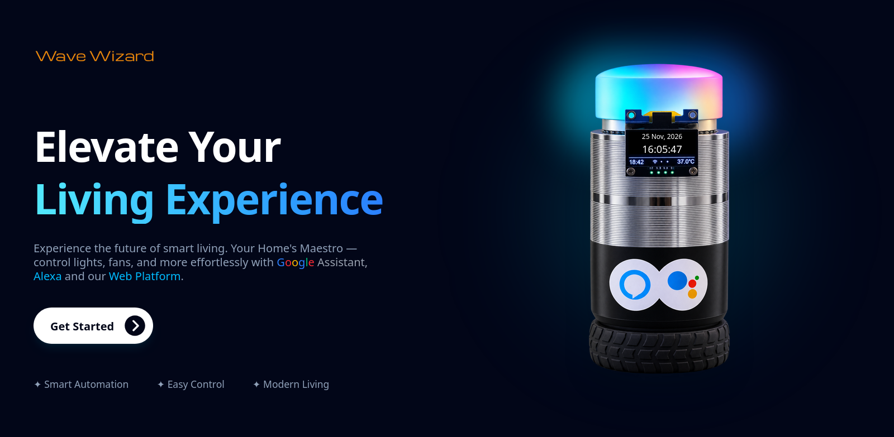
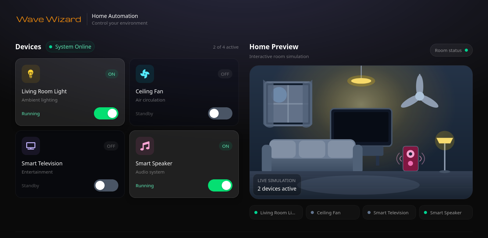

# Wave Wizard — Smart Home Automation

Wave Wizard is an IoT-based home automation project with a web interface for controlling household devices and viewing their states in a simulated living-room environment.

The project combines a React web UI with ESP-based hardware and a relay module. The web dashboard is designed to control four device channels: a living-room light, ceiling fan, television, and speaker.

> **Project note:** This repository presents the web-interface portion and hardware overview of the project. The ESP32 and ESP8266 Arduino (`.ino`) firmware files are not included in this public repository.

## Project highlights

- **Four device controls:** Light, fan, television, and speaker.
- **Interactive dashboard:** Device cards show ON/OFF state and the number of active devices.
- **Room visualization:** The living-room preview responds to the UI state:
  - The light changes the room lighting effect.
  - The fan animation runs when the fan is switched on.
  - The television screen changes when the TV is switched on.
  - The speaker changes appearance and displays sound-wave animation when active.
- **Responsive interface:** Layout adapts to smaller and larger screens.
- **Local-network device requests:** The current frontend sends HTTP GET requests to the controller at `192.168.4.1`.
- **Landing page:** Introduces the project and transitions to the control dashboard.

## Screenshots

### Landing page



### Device dashboard



### Hardware circuit diagram


## Hardware overview

The supplied circuit diagram shows the following main hardware elements:

- ESP8266 NodeMCU v3 development board
- ESP32 development board
- Four-channel relay module
- Battery pack and power adapter
- Four push buttons
- Audio jack / audio connection
- Connected household-device loads represented in the circuit diagram

The diagram is provided as a project reference. Confirm the exact pin mapping, supply requirements, relay ratings, grounding, and load wiring against your own hardware and firmware before building or powering the circuit.

## Software used

The supplied frontend code uses:

- React
- React Router (`react-router-dom`)
- Tailwind CSS utility classes
- `react-icons`
- JavaScript and CSS

The firmware is written for ESP32 / ESP8266 using the Arduino IDE, but those `.ino` files are intentionally not published here.

## How the web interface works

### Landing page

The landing page displays the Wave Wizard introduction, a device image, and a **Get Started** button. Selecting the button displays a loader and navigates to `/controlPage` after a short delay.

### Control dashboard

The dashboard maintains UI state for four devices and maps each device to an HTTP endpoint:

| Device | UI key | Turn on | Turn off |
|---|---|---|---|
| Living Room Light | `yellow` | `/relayon1` | `/relayoff1` |
| Ceiling Fan | `cyan` | `/relayon2` | `/relayoff2` |
| Smart Television | `violet` | `/relayon3` | `/relayoff3` |
| Smart Speaker | `pink` | `/relayon4` | `/relayoff4` |

The current frontend builds requests using this base address:

```text
http://192.168.4.1
```

When a user changes a toggle, the interface updates immediately and sends a GET request to the corresponding endpoint. If the request fails, the UI restores the previous state.

**Important:** `192.168.4.1` is the address currently written in the supplied frontend code. Your controller must be configured to serve the matching routes at that address, or you must update the frontend URLs to match your network and firmware configuration.

## Run the frontend

1. Clone this repository:

   ```bash
   git clone https://github.com/<your-username>/<your-repository>.git
   cd <your-repository>
   ```

2. Install the dependencies for your React project:

   ```bash
   npm install
   ```

3. Start the development server using the script configured in your project:

   ```bash
   npm run dev
   ```

   If your project uses Create React App or another build tool, use the corresponding start command from `package.json`.

4. Connect your computer to the same network as the ESP controller and make sure the firmware exposes the four relay routes listed above.

5. Open the local development URL shown in your terminal.

> This README is based on the frontend source and project images supplied for documentation. A `package.json` was not supplied, so the exact build tool, scripts, and complete dependency list have not been verified.

## Repository structure

A suggested structure for publishing the frontend is:

```text
wave-wizard/
├── public/
├── src/
│   ├── assets/
│   │   ├── device.png
│   │   └── logo.png
│   ├── components/
│   │   ├── Background2.jsx
│   │   ├── Loader.jsx
│   │   ├── Navbar.jsx
│   │   └── ToggleBtn.jsx
│   ├── hook/
│   │   └── Date_and_TIme.js
│   ├── pages/
│   │   ├── Home.jsx
│   │   └── ControlPage.jsx
│   ├── App.css
│   └── ...
├── docs/
│   └── images/
│       ├── wave-wizard-landing.png
│       ├── wave-wizard-dashboard.png
│       └── wave-wizard-circuit.png
└── README.md
```

This is an example layout for organizing the project; adjust filenames and folders to match your actual source tree.

## Firmware and integration

The ESP32 and ESP8266 `.ino` files are not part of this public release. As a result, this repository does not document or verify the firmware's internal pin assignments, board-to-board communication, Wi-Fi configuration, or relay-control implementation.

For the web UI to control physical devices, the firmware/network service needs to provide these routes:

- `GET /relayon1` and `GET /relayoff1`
- `GET /relayon2` and `GET /relayoff2`
- `GET /relayon3` and `GET /relayoff3`
- `GET /relayon4` and `GET /relayoff4`

The landing-page copy mentions Google Assistant and Alexa. Voice-assistant integration details are not included in the supplied frontend/controller material, so they are not described here as verified features.

## Safety

This project interfaces with relay-controlled electrical loads. Mains voltage can cause serious injury, fire, or equipment damage.

- Do not work on live mains wiring.
- Use relays, power supplies, wiring, enclosures, and protection devices rated for the actual load and local electrical standards.
- Keep low-voltage logic wiring isolated from mains wiring.
- Get the circuit reviewed and assembled by someone qualified to work with mains electricity.
- Test the control logic with safe low-voltage loads before connecting household appliances.

## Future improvements

Potential next steps for the project include:

- Add device-state feedback from the controller instead of relying only on optimistic frontend state.
- Add connection status, request timeouts, and clearer error messages.
- Move the controller address into environment/configuration settings.
- Add authentication and network-access controls before exposing the system beyond a trusted local network.
- Document the ESP32/ESP8266 firmware and verified wiring/pin map if those details are later made public.

## About this project

Wave Wizard was developed as an IoT / home-automation project and is also being presented as an interview project. The public repository focuses on the web UI, interaction flow, and hardware concept while keeping the Arduino firmware source unpublished.

---

**Author:** Prasanta Debnath  
**Project:** Wave Wizard — Smart Home Automation
